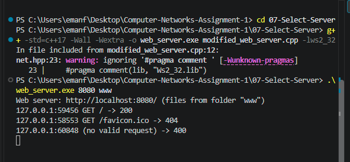
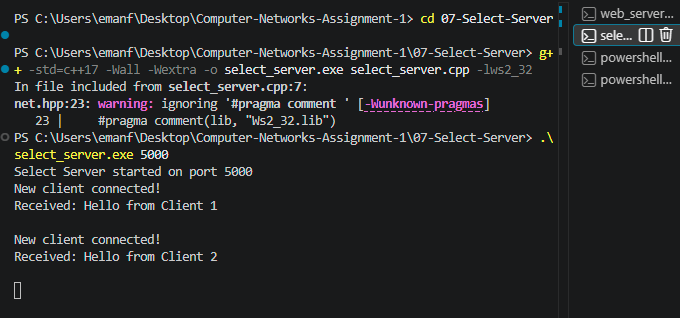
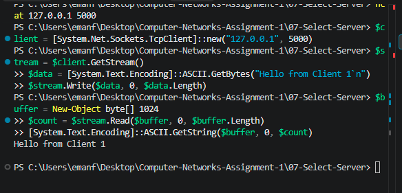
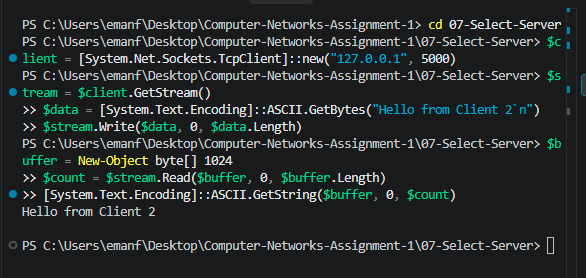
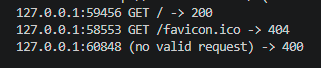

# How It Works

The Select Server is a TCP server written in C++. It uses the `select()` system call to monitor the listening socket and multiple connected client sockets. This allows the server to handle more than one client in a single event loop.

1.  **Initialize networking:** `net::Runtime` initializes the networking
    environment.
2.  **Create the listening socket:** `net::tcp_listen(port)` creates a
    TCP socket that waits for incoming connections.
3.  **Prepare the socket set:** `FD_ZERO()` clears the `fd_set`, and
    `FD_SET()` adds the listening socket and all connected client
    sockets to the set.
4.  **Monitor socket activity:** `select()` waits until one or more
    sockets become readable.
5.  **Accept new clients:** If the listening socket is ready, `accept()`
    accepts the incoming connection and the new socket is stored in the
    clients vector.
6.  **Receive client data:** For each ready client socket,
    `net::recv_some()` receives the incoming data.
7.  **Echo the message:** `net::send_all()` sends the received data back
    to the same client.
8.  **Handle disconnections:** If receiving fails or the client
    disconnects, the socket is removed from the clients vector.

The server repeats these steps in a loop so it can continue monitoring
new and existing connections.

## Compilation and Execution

Open a terminal in the `07-Select-Server` directory.

### Compile

``` powershell
g++ -std=c++17 -Wall -Wextra -o select_server.exe select_server.cpp -lws2_32
```

### Run

``` powershell
.\select_server.exe 5000
```

Expected startup message:

``` text
Select Server started on port 5000
```

> **Note:** MinGW may display a warning that it ignores
> `#pragma comment(lib, "Ws2_32.lib")` in `net.hpp`. This is a
> compiler-specific pragma. The command above explicitly links Winsock
> using `-lws2_32`.

## Client Testing

The server was tested using two separate PowerShell TCP clients
connected to `127.0.0.1` on port `5000`.

### Client 1

The first client sent:

``` text
Hello from Client 1
```

The server received the message and echoed it back. The client received:

``` text
Hello from Client 1
```

### Client 2

The second client sent:

``` text
Hello from Client 2
```

The server received the message and echoed it back. The client received:

``` text
Hello from Client 2
```

### Test Results

  -----------------------------------------------------------------------
  Test                    Expected result         Observed result
  ----------------------- ----------------------- -----------------------
  Start server on port    Server starts           Successful
  5000                    successfully            

  Connect Client 1        Connection accepted     Successful

  Send message from       Server receives and     Successful
  Client 1                echoes message          

  Connect Client 2        Second connection       Successful
                          accepted                

  Send message from       Server receives and     Successful
  Client 2                echoes message          
  -----------------------------------------------------------------------

Both clients connected to the same running server and received their
respective echoed messages.

### Compilation

Shows the g++ compilation command and its terminal output.



### Server Execution

Shows the Select Server running on port 5000 and the server-side output
for both client connections and received messages.



### Client 1



### Client 2


### Client Testing

Shows the PowerShell client tests and the echoed responses received by
Client 1 and Client 2.




