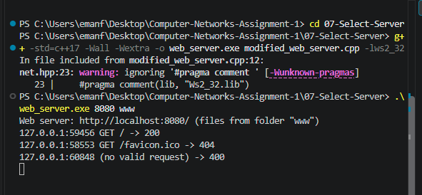

# Computer Networks Assignment 1

## Select Server

This section implements a TCP echo server using the `select()` system call.
The server monitors the listening socket and multiple connected client
sockets in a single process. It accepts connections, receives messages, echoes
each message back to its sender, and removes disconnected or failed clients.

### How the Server Works

1. `net::Runtime` initializes Winsock on Windows or the signal configuration on
   Linux.
2. `net::tcp_listen(port)` creates and binds a TCP listening socket.
3. `FD_ZERO()` clears the read socket set.
4. `FD_SET()` adds the listening socket and every connected client socket to the
   set.
5. `select()` waits until at least one socket is readable. The first argument is
   `max_fd + 1` on Linux and is also valid when compiling with Winsock.
6. If the listening socket is ready, `accept()` accepts a new connection and
   stores it in the client vector.
7. For each ready client, `net::recv_some()` receives data.
8. `net::send_all()` echoes the received data back to the same client.
9. A client with an error or zero-byte receive is disconnected and removed.

The server repeats these steps so it can monitor new and existing connections
without starting a separate thread for each client.

## Compilation and Execution

Open a terminal in the `07-Select-Server` directory.

### Windows with MinGW

Compile the server with:

```powershell
g++ -std=c++17 -Wall -Wextra -o select_server.exe select_server.cpp -lws2_32
```

Run it on port `5000`:

```powershell
.\select_server.exe 5000
```

Expected startup output:

```text
Select Server started on port 5000
```

MinGW may warn that it ignores `#pragma comment(lib, "Ws2_32.lib")`. This
pragma is compiler-specific; the `-lws2_32` option explicitly links the
required Winsock library.

Stop the server with `Ctrl+C`.

## Client Testing

The server was tested using two PowerShell TCP clients connected to
`127.0.0.1` on port `5000`.

### PowerShell Test Client

A client can be created with:

```powershell
$tcp = New-Object System.Net.Sockets.TcpClient("127.0.0.1", 5000)
$stream = $tcp.GetStream()
$writer = New-Object System.IO.StreamWriter($stream)
$writer.AutoFlush = $true

$writer.WriteLine("Hello from Client")

$reader = New-Object System.IO.StreamReader($stream)
$reader.ReadLine()
```

### Client 1

Client 1 sent:

```text
Hello from Client 1
```

The server printed:

```text
New client connected!
Received: Hello from Client 1
```

Client 1 received the same text as an echoed response.

### Client 2

Client 2 sent:

```text
Hello from Client 2
```

The server printed:

```text
New client connected!
Received: Hello from Client 2
```

Client 2 received the same text as an echoed response.

### Test Results

| Test | Expected result | Observed result |
|---|---|---|
| Start server on port 5000 | Server starts successfully | Successful |
| Connect Client 1 | Connection accepted | Successful |
| Send message from Client 1 | Server receives and echoes message | Successful |
| Connect Client 2 | Second connection accepted | Successful |
| Send message from Client 2 | Server receives and echoes message | Successful |

Both clients remained connected to the same server and received their
respective echoed messages.

## Evidence

### Compilation

The following screenshot shows the g++ compilation command and output:



### Server Execution

The following screenshots show the Select Server, client connections, and
server-side received messages:


### Client Testing

The following screenshot shows the PowerShell client testing:


